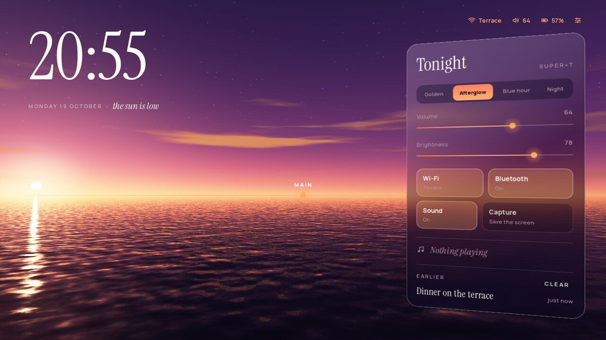
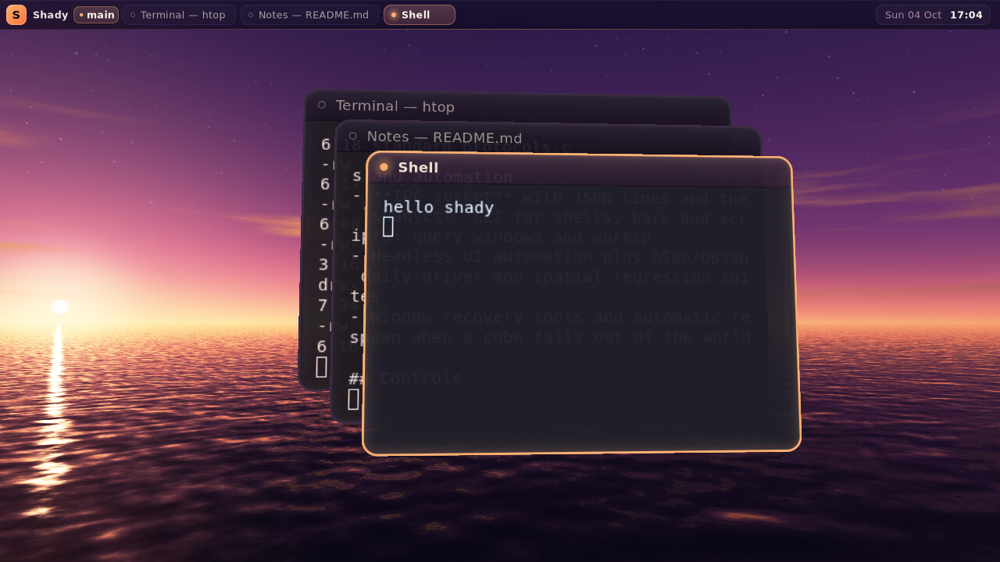
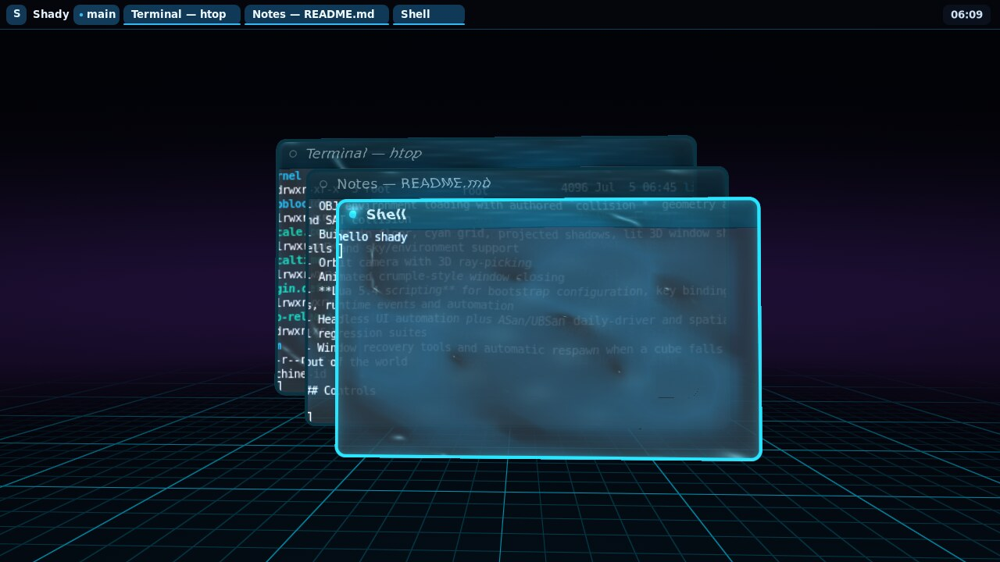

# shady



*Horizon, the default rice: shady-shell living in Afterglow's procedural sky and sea. The time is written across the sky, workspaces are lights on the horizon with the open windows reflected below, notifications appear in the sky, the control center is a slab of frosted glass turned in 3D that also picks the hour (`Super+T`), and the launcher scatters the applications as stars.*

Shady is an experimental **3D Wayland compositor** built on wlroots 0.20.2 and inspired by TinyWL. It can run as a conventional compositor through its wlroots scene-graph path, or turn normal xdg-shell applications into objects inside a shared perspective 3D world.

Windows can move through depth, fold into cubes, collide with authored environments, be picked up and thrown, or receive native-plugin-driven surface effects. Shady also includes a standalone layer-shell desktop shell, Lua configuration and runtime scripting, and a public C plugin API for extending spatial behavior without putting every experiment into the compositor core.

## Try it

From any Wayland desktop, with [Nix](https://nixos.org/download):

```sh
nix run github:gloaming-dusk/shady
```

Horizon opens in a window with a terminal. Press **`Super+Shift+/`** to see
every shortcut. [Getting started](docs/GETTING_STARTED.md) covers building
from a checkout, installing on NixOS or elsewhere, the keys and your own
configuration.

## Rices

A rice pairs the compositor with a shell and a look. Pick one with
`SHADY_RICE` (`SHADY_RICE=objects nix run github:gloaming-dusk/shady`) or
`programs.shady.rice` in the NixOS module.

| | |
|---|---|
| [](rices/horizon/README.md) **[Horizon](rices/horizon/README.md)**, the default: the shell lives in the sky, with a 3D-turned glass control center and a constellation launcher. | [](rices/objects/README.md) **[Objects](rices/objects/README.md)**: chunky ink-outlined cards on a paper sunset, a desk clock, a dock and a launcher that fans the apps out like a hand of cards. |
| [](rices/afterglow/README.md) **[Afterglow](rices/afterglow/README.md)**: the desktop above an open sea at sunset, cycling through four hours with `Super+T`, its frosted shell following the sky. | [](rices/neon-transit/README.md) **[Neon Transit](rices/neon-transit/README.md)**: a near-black world with a violet horizon and an electric-cyan grid, with the 3D overview and opt-in water, depth, magnetic and portal modes. |

## Highlights

- A custom GLES2 renderer that places Wayland surfaces in a perspective 3D world, with a plain 2D scene-graph path (`--safe`) as the compatibility baseline
- Windows with physics: gravity, wobble, collision with authored OBJ environments, first-person navigation, picking up and throwing
- Window bodies defined by plugins: cubes, jelly, folded paper and origami share one shape for drawing, picking and collision
- `shady-shell`, a separate shell whose bars, panels, launcher and notifications are a hot-reloaded Lua config, with GLSL effects, frosted glass and 3D-placed layer surfaces
- A shortcut overlay (`Super+Shift+/`) listing every key of the session: the compositor's, the rice's and each plugin's
- Lua 5.4 for configuration (`config.lua`), runtime scripting (`init.lua`) and headless UI automation
- A public C plugin API with hot reload and state migration, and an IPC socket with the `shadyctl` CLI for scripts and other bars
- Input methods, fractional scaling, session lock, screencopy and the standard toplevel and workspace protocols ([Desktop integration](docs/DESKTOP.md))
- ASan/UBSan regression suites for the 2D and 3D paths, and NixOS VM tests of the session and greeter

## Plugins

Load one with `shady.plugins.load("<name>")` in `config.lua`. The shipped
rices load several.

| Plugin | Keys | |
|---|---|---|
| `spatial-overview` | `Super+O` | 3D overview of the workspace's windows |
| `water-windows` | `Super+W` | windows turn to water: waves, refraction, caustics |
| `frozen-window` | `Super+Z`, `Super+Shift+Z` | frost grows over a window, or the whole workspace, and melts away |
| `black-hole` | `Super+H` | the workspace's windows fall into a black hole and a white hole returns them |
| `magnetic-windows` | `Super+M` | nearby windows dock together on springs |
| `window-constellation` | `Super+C` | the other windows orbit the focused one |
| `window-portal` | `Super+P`, `Super+Shift+P` | a live portal onto another window |
| `border-accent` | `Super+B` | accent the focused window's border |
| `afterglow` | `Super+T`, `Super+Shift+T` | procedural sky and sea through four hours (Afterglow, Horizon) |
| `focus-depth` | | the focused window comes forward in depth |
| `fps-cube`, `fps-jelly`, `fps-squash`, `fps-folded-paper`, `fps-origami` | | window bodies in first-person mode |
| `close-slide-fade`, `close-burn` | | other close animations |
| `window-motion` | | wobble and tilt (loaded by default) |
| `obj-loader` | | loads `.obj` environments when one is configured |

Writing one: [C plugin API](docs/C_PLUGIN_API.md), starting from
`examples/plugins/hello.c`.

## Documentation

- [Getting started](docs/GETTING_STARTED.md): run, install, keys, configure
- [API overview](docs/API.md): which interface fits which job
- [Lua API](docs/LUA_API.md) · [Shell Lua API](docs/SHELL_LUA_API.md) · [IPC API](docs/IPC_API.md) · [Headless / automation API](docs/HEADLESS_API.md)
- [C plugin API](docs/C_PLUGIN_API.md) · [Plugin manager](docs/PLUGIN_MANAGER.md) · [Shader API](docs/SHADER_API.md) · [Environment API](docs/ENVIRONMENT_API.md) · [Shell plugin API](docs/SHELL_PLUGIN_API.md)
- [Desktop integration](docs/DESKTOP.md) · [Greeter](docs/GREETER.md) · [Shell design](docs/SHELL_DESIGN.md)
- [Development](docs/DEVELOPMENT.md): layout, build options, tests · [Architecture](docs/ARCHITECTURE.md)

The project site, <https://gloaming-dusk.github.io/shady/>, is built from
[shady-website](https://github.com/gloaming-dusk/shady-website) and renders
these `docs/*.md` files directly; `.github/workflows/pages.yml` deploys it.

## What this repository holds

- `shady`, the compositor (`compositor/`, `plugins/`, `include/shady/`),
- `shady-shell`, the standalone layer-shell desktop shell (`shell/`),
- the rices that pair them (`rices/`), the greetd greeter built from both
  (`greeter/`), and the flake with the package, the NixOS module and its VM
  tests (`flake.nix`, `nix/`).

Nothing here is tied to a distribution: any NixOS system can use the module,
and other systems build with Meson.

## Status

Shady is a research compositor, not a production desktop: expect rough
edges, especially with multiple outputs and in first-person mode. Areas
under active work include per-window scripting actions, player collision
against triangle geometry, richer environment semantics, better shadow
receivers, multi-output behavior and rendering polish. Changes are listed
in [CHANGELOG.md](CHANGELOG.md).

## License

Apache-2.0; see [LICENSE](LICENSE). The imported TinyWL example is CC0;
see [its license](LICENSES/tinywl-CC0.txt).
