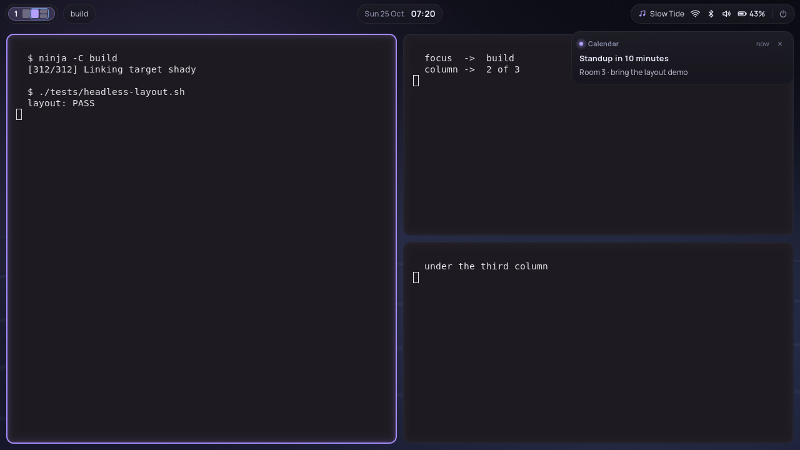
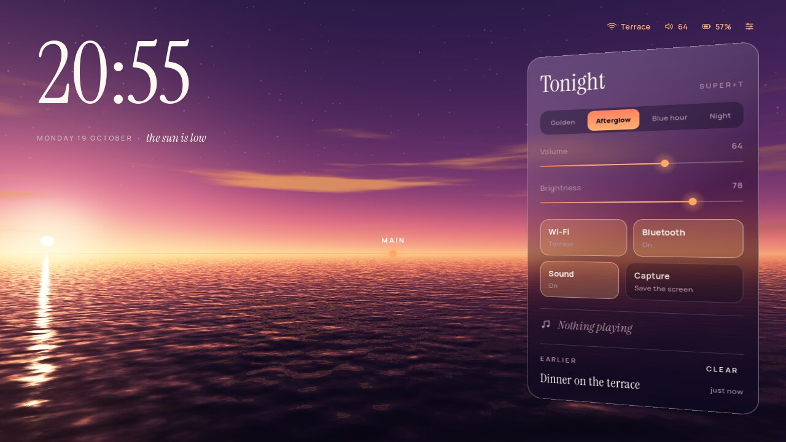
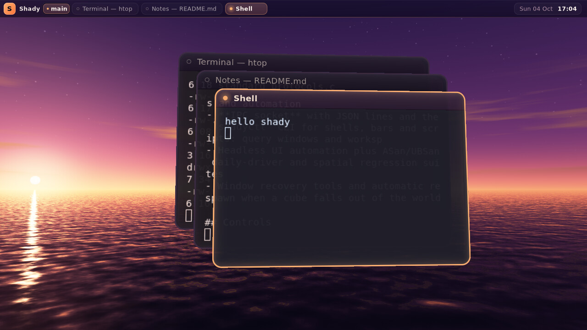

# shady



*Tide, the default desktop: niri's scrolling columns and keys under a glass bar with a minimap of the strip, with a control center, launcher, lock screen and login screen of its own.*

Shady is an experimental **3D Wayland compositor** built on wlroots 0.20.2 and inspired by TinyWL. It can run as a conventional compositor through its wlroots scene-graph path, or turn normal xdg-shell applications into objects inside a shared perspective 3D world.

Windows can move through depth, fold into cubes, collide with authored environments, be picked up and thrown, or receive native-plugin-driven surface effects. Shady also includes a standalone layer-shell desktop shell, Lua configuration and runtime scripting, and a public C plugin API for extending spatial behavior without putting every experiment into the compositor core.

## Try it

From any Wayland desktop, with [Nix](https://nixos.org/download):

```sh
nix run github:gloaming-dusk/shady
```

Tide opens in a window with a terminal. Press **`Super+Shift+/`** to see
every shortcut. [Getting started](docs/GETTING_STARTED.md) covers building
from a checkout, installing on NixOS or elsewhere, the keys and your own
configuration.

## Make it yours

Tide is what Shady is out of the box, and where you start changing it
([Customizing](docs/CUSTOMIZING.md)):

- **Build on it.** `shady.base("tide")` and `shell.base("tide", { ... })` at the
  top of your config, then change colours, keys, bar islands or control center
  tiles. Tide's updates keep reaching you.
- **Take it apart.** `shady-rice eject` copies Tide into `~/.config/shady`, and
  all of it is yours to rewrite.
- **Start from nothing.** `SHADY_RICE=none` is the bare compositor; every rice
  and plugin made for it still works.

## Rices

Other looks are a setting away: `SHADY_RICE=horizon nix run
github:gloaming-dusk/shady`, or `programs.shady.rice` in the NixOS module.

| | |
|---|---|
| [](rices/horizon/README.md) **[Horizon](rices/horizon/README.md)**: the shell lives in the sky, with a 3D-turned glass control center and a constellation launcher. | [](rices/afterglow/README.md) **[Afterglow](rices/afterglow/README.md)**: the desktop above an open sea at sunset, cycling through four hours with `Super+T`, its frosted shell following the sky. |

More live in their own repositories:
[Objects](https://github.com/gloaming-dusk/shady-rice-objects),
[Neon Transit](https://github.com/gloaming-dusk/shady-rice-neon-transit),
[Gensokyo](https://github.com/gloaming-dusk/shady-rice-touhou),
[Stage](https://github.com/gloaming-dusk/shady-rice-miku) and
[retired ones](https://github.com/gloaming-dusk/shady-rice-archive).

## Highlights

- A custom GLES2 renderer that places Wayland surfaces in a perspective 3D world, with a plain 2D scene-graph path (`--safe`) as the compatibility baseline
- Windows with physics: gravity, wobble, collision with authored OBJ environments, first-person navigation, picking up and throwing
- Window bodies defined by plugins: cubes, jelly, folded paper and origami share one shape for drawing, picking and collision
- `shady-shell`, a separate shell whose bars, panels, launcher and notifications are a hot-reloaded Lua config, with GLSL effects, frosted glass and 3D-placed layer surfaces
- A scrolling tiling layout (`layout = "scrolling"`): niri's strip of columns, with touchpad swipes, animated scrolling and workspace slides, and a 3D overview of the strip
- Rewind: the desktop records each layout it settles into; `Super+BackSpace` scrubs back through them, the world fading like an old photograph, and `Return` restores that moment
- A shortcut overlay (`Super+Shift+/`) listing every key of the session: the compositor's, the rice's and each plugin's
- Lua 5.4 for configuration (`config.lua`), runtime scripting (`init.lua`) and headless UI automation
- A public C plugin API with hot reload and state migration, and an IPC socket with the `shadyctl` CLI for scripts and other bars
- Input methods, fractional scaling, session lock, screencopy and the standard toplevel and workspace protocols ([Desktop integration](docs/DESKTOP.md))
- ASan/UBSan regression suites for the 2D and 3D paths

Run Lua in the live compositor with `shadyctl lua`:

```sh
shadyctl lua 'shady.workspace("two")'
shadyctl lua 'return shady.current_workspace(), shady.workspaces()'
shadyctl lua -f script.lua
printf 'return shady.focused_window().title\n' | shadyctl lua -
```

Commands share the runtime used by `init.lua`, including its globals and
functions. Return values are printed as a JSON array; errors exit with status 1.
See the [IPC API](docs/IPC_API.md#running-lua) for details.

## Plugins

Load one with `shady.plugins.load("<name>")` in `config.lua`. The shipped
rices load several.

| Plugin | Keys | |
|---|---|---|
| `rewind` | `Super+BackSpace` | scrub back through earlier layouts of the desktop and restore one (Afterglow, Horizon) |
| `spatial-overview` | `Super+O` | 3D overview of the workspace's windows |
| `border-accent` | `Super+B` | accent the focused window's border |
| `afterglow` | `Super+T`, `Super+Shift+T` | procedural sky and sea through four hours (Afterglow, Horizon) |
| `focus-depth` | | the focused window comes forward in depth |
| `fps-cube`, `fps-jelly`, `fps-squash`, `fps-folded-paper`, `fps-origami` | | window bodies in first-person mode |
| `close-slide-fade` | | another close animation |
| `window-motion` | | wobble and tilt (loaded by default) |
| `obj-loader` | | loads `.obj` environments when one is configured |

More are in [shady-plugins](https://github.com/gloaming-dusk/shady-plugins):
`water-windows`, `frozen-window`, `black-hole`, `window-portal`,
`magnetic-windows`, `window-constellation`, `bad-apple` and others.

Writing one: [C plugin API](docs/C_PLUGIN_API.md), starting from
`examples/plugins/hello.c`.

## Documentation

- [Getting started](docs/GETTING_STARTED.md): run, install, keys, configure
- [Customizing](docs/CUSTOMIZING.md): build on Tide, take it apart, or start from nothing
- [API overview](docs/API.md): which interface fits which job
- [Lua API](docs/LUA_API.md) · [Shell Lua API](docs/SHELL_LUA_API.md) · [IPC API](docs/IPC_API.md) · [Headless / automation API](docs/HEADLESS_API.md)
- [C plugin API](docs/C_PLUGIN_API.md) · [Plugin manager](docs/PLUGIN_MANAGER.md) · [Shader API](docs/SHADER_API.md) · [Environment API](docs/ENVIRONMENT_API.md) · [Shell plugin API](docs/SHELL_PLUGIN_API.md)
- [Desktop integration](docs/DESKTOP.md) · [Greeter](docs/GREETER.md) · [Shell design](docs/SHELL_DESIGN.md)
- [Development](docs/DEVELOPMENT.md): layout, build options, tests · [Architecture](docs/ARCHITECTURE.md)

Shady is the compositor of [Gloam](https://github.com/gloaming-dusk/gloam), a
desktop. Its site, <https://gloaming-dusk.github.io/>, renders these `docs/*.md`
files directly; its source is in
[gloaming-dusk.github.io](https://github.com/gloaming-dusk/gloaming-dusk.github.io).

## What this repository holds

- `shady`, the compositor (`compositor/`, `plugins/`, `include/shady/`),
- `shady-shell`, the standalone layer-shell desktop shell (`shell/`),
- the rices that pair them (`rices/`), the greetd greeter built from both
  (`greeter/`), and the flake with the package, the NixOS module and its VM
  tests (`flake.nix`, `nix/`).

Nothing here is tied to a distribution: any NixOS system can use the module,
and other systems build with Meson.

## Status

Shady is a research compositor, not a production desktop: expect rough
edges, especially with multiple outputs and in first-person mode. Areas
under active work include per-window scripting actions, player collision
against triangle geometry, richer environment semantics, better shadow
receivers, multi-output behavior and rendering polish. Changes are listed
in [CHANGELOG.md](CHANGELOG.md).

## License

Apache-2.0; see [LICENSE](LICENSE). The imported TinyWL example is CC0;
see [its license](LICENSES/tinywl-CC0.txt).
