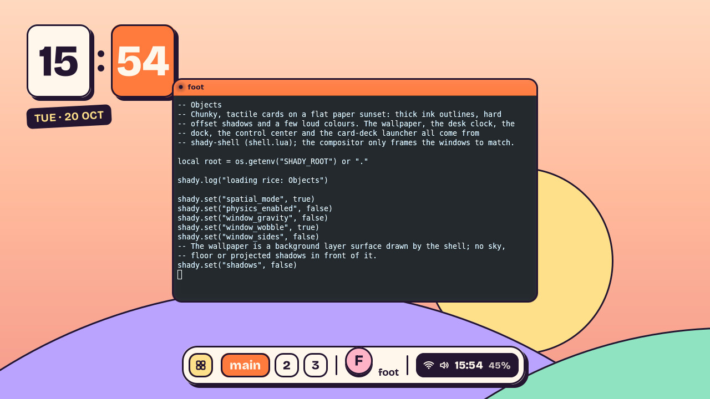

# Objects



Chunky, tactile cards on a flat paper sunset. Everything is a physical-looking
object with a thick ink outline and a hard offset shadow:

- a paper-sunset wallpaper (a `background` layer drawn by the shell),
- a desk clock of two number tiles with a date sticker,
- a floating dock: launcher, workspaces, window avatars (the focused one
  lifted), the focused title and a status pill,
- a control center that leans like a remote on the table: Wi-Fi, Bluetooth,
  mute, screenshot, volume and brightness sliders (drag, click or scroll),
  the playing media and a quit button,
- a launcher that fans the matching applications out like a hand of cards,
  the best match in the middle (type to filter, ← → to choose, ↵ to launch),
- a window menu on right-clicking an avatar (middle-click closes).
- notifications as stickers slapped on the top-right corner (critical ones
  in tangerine), with their actions; the control center keeps the last few.

```bash
nix develop -c ./tools/build.sh
nix develop -c ./rices/objects/run.sh          # nested in a Wayland session
nix develop -c ./rices/objects/run-native.sh   # directly on a VT (DRM + libinput)
```

| Keys | |
|---|---|
| `Super+Return` | terminal |
| `Super+d` | launcher |
| `Super+1..3`, `Super+Shift+1..3` | go to / move to workspace main, work, play |
| `Super+Tab` | next window |
| `Super+q` | close the window |
| `Super+m`, `Super+Shift+m` | maximize, fullscreen |
| `Super+O` | 3D overview |
| `Super+Shift+Escape` | quit |

The control center talks to the system through ordinary tools, each
optional: `wpctl` (PipeWire), `brightnessctl`, `nmcli`, `bluetoothctl`,
`playerctl` and `grim`. A control whose tool is missing is greyed out or
hidden.

The typeface is [Bricolage Grotesque](https://github.com/ateliertriay/bricolage)
(`fonts/`, SIL Open Font License 1.1, see `fonts/OFL.txt`).
