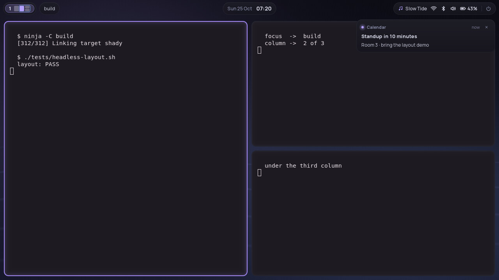
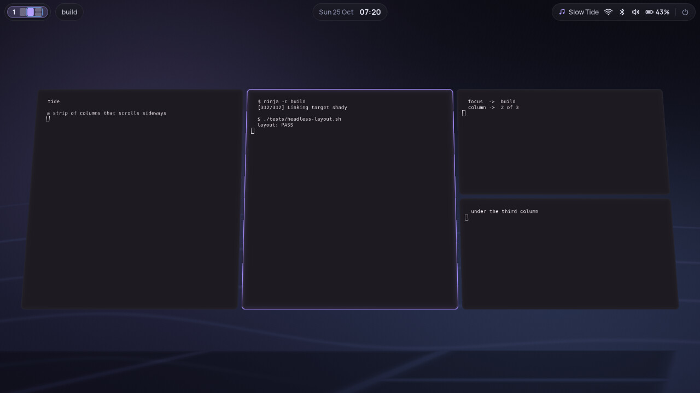
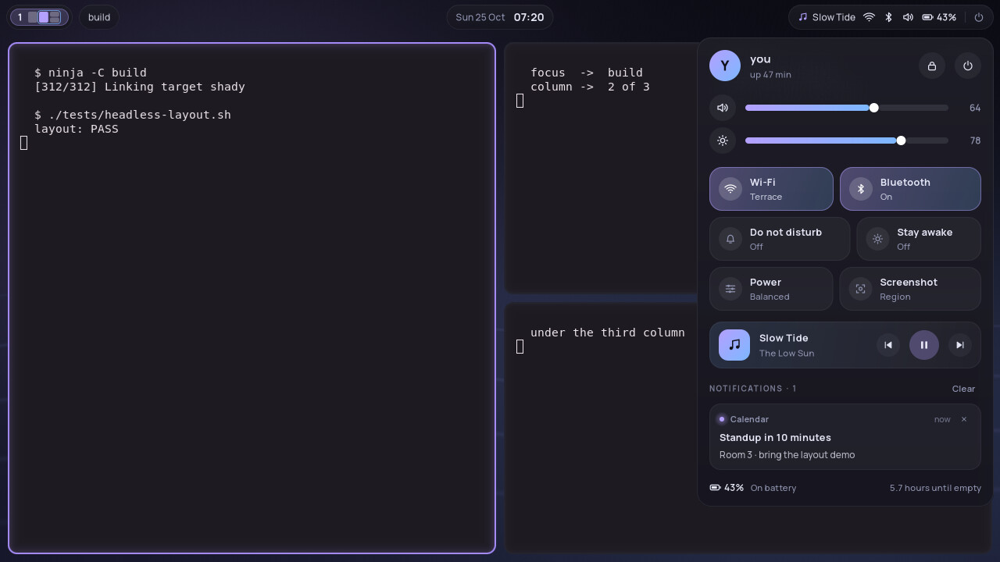
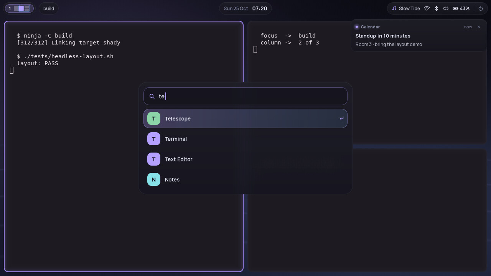
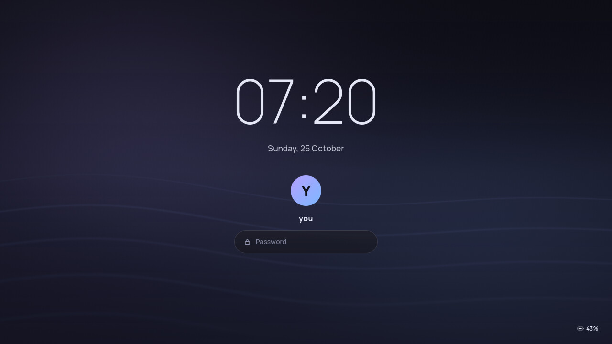

# Tide



An everyday desktop. Windows tile in a strip of columns that scrolls
sideways, niri's model, and the keys are niri's defaults, so moving over
from niri needs no relearning:

- a new window opens as a column right of the focused one, half the screen
  wide; moving the focus glides the strip so the focused column is on
  screen (`Super+←/→`, `Super+h/l`), and a column stacks windows
  (`Super+[`/`]` to join or leave one),
- `Super+R` steps a column through ⅓, ½ and ⅔ of the screen,
  `Super+-`/`=` narrows and widens it, `Super+F` fills the screen with it,
  `Super+V` floats a window and back,
- workspaces are numbered and made as needed: `Super+1…9`,
  `Super+Page Up/Down` or `U`/`I`, `Super`+wheel, or a three-finger swipe up
  and down; a sideways swipe scrolls the strip,
- `Super+O` pulls the camera back over the whole strip, tilted a little;
  click a window to fly back into it.



The shell floats over the top edge as three glass islands: the workspaces,
with a live minimap of the current strip (its columns, the focused one lit,
the part on screen framed); the clock (click: a calendar); and the
system's state (click: the control center, `Super+S`).



- **Control center**: volume and brightness, Wi-Fi, Bluetooth, do not
  disturb, stay awake, the power profile, a region screenshot, what is
  playing, the notifications and the battery.
- **Launcher** (`Super+Space`): applications ordered by how often you
  launch them; `= 12*7` calculates (Enter copies the result), `> cmd` runs
  a command, and "lock", "suspend", "restart" match the session's commands.
- **Power menu** (`Super+Shift+E`): lock, log out, suspend, restart, shut
  down.
- **OSD**: volume and brightness keys show a bar at the bottom.
- **Lock screen** (`Super+Alt+L`, and after five minutes idle): the shell's
  own, over the same sea, checked with PAM; with a fingerprint reader it
  listens to the reader and the password field at once. The screen turns
  off half a minute later. A playing video holds both back.

 

```bash
nix develop -c ./tools/build.sh
nix develop -c ./rices/tide/run.sh          # nested in a Wayland session
nix develop -c ./rices/tide/run-native.sh   # directly on a VT (DRM + libinput)
```

On NixOS, with the flake's module:

```nix
programs.shady = {
  enable = true;
  rice = "tide";
  greeter.enable = true;     # greetd with Shady's greeter, instead of SDDM
  greeter.theme = "tide";
};
```

`Super+Shift+/` lists every key. `TIDE_LIGHT=1` draws through wlroots'
scene graph instead of the GL renderer: no rounded corners, glass or
overview, and the least GPU work. `TIDE_IDLE_LOCK` and
`TIDE_IDLE_SCREEN_OFF` (seconds, 0 for never) change the idle times;
`TIDE_XKB_LAYOUT` and `TIDE_XKB_OPTIONS` the keyboard. A PNG at
`~/.config/shady/wallpaper.png` replaces the night sea.

The shell uses optional tools when they are installed: `wpctl`, `nmcli`,
`bluetoothctl`, `powerprofilesctl`, `playerctl`, `upower`, `grim`, `slurp`,
`wl-copy` and `notify-send`; the NixOS module installs the ones that are
not already part of a desktop. The lock screen checks passwords with the
`shady-lock` PAM service (and fingerprints with `shady-lock-fingerprint`),
which the module sets up; elsewhere it falls back to `swaylock`'s or
`login`'s.

`capture.sh` regenerates the pictures.
